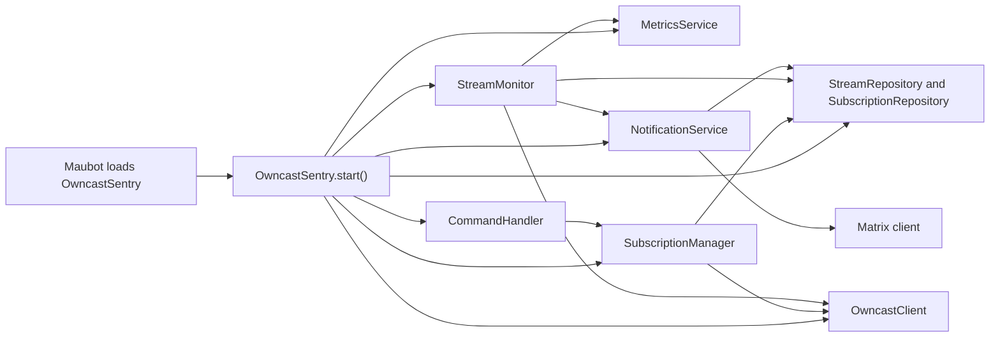
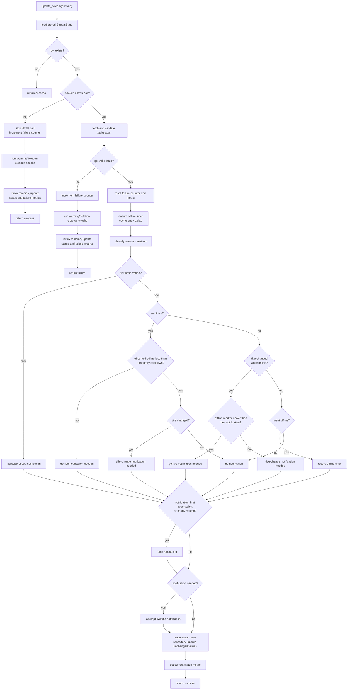
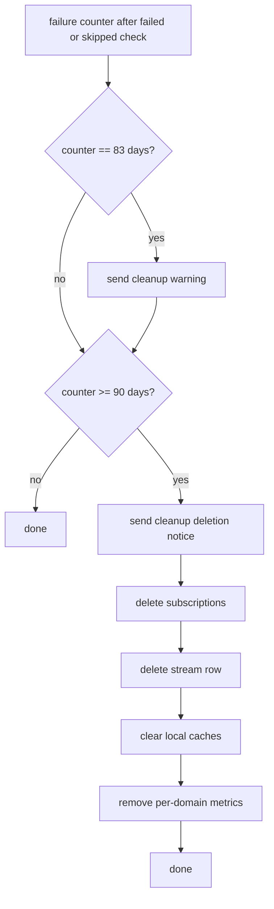

# OwncastSentry Package

This package contains the Maubot plugin runtime code for OwncastSentry. It
tracks room subscriptions to Owncast instances, polls subscribed streams,
detects stream state changes, and sends Matrix notifications.

This README gives maintainers a high-level map of how the package fits
together and where the important behavior lives. User-facing setup and command
usage belong outside this package. Function-level details belong in docstrings
or tests.

## Files

- `__init__.py`: Maubot plugin entry point, service wiring, command
  decorators, scheduler loop, shutdown, and metrics endpoint.
- `config.py`: Maubot configuration proxy for the Prometheus metrics endpoint
  setting.
- `types.py`: immutable value objects, Owncast API response validation, derived
  stream status, update results, and subscription domain errors.
- `repository.py`: database schema migrations plus stream and subscription
  repositories.
- `owncast_client.py`: bounded aiohttp client for Owncast `/api/status` and
  `/api/config` requests.
- `subscription_manager.py`: subscription use cases, domain normalization, and
  first-subscription Owncast validation.
- `stream_monitor.py`: stream update orchestration, state transition detection,
  progressive failure backoff, cleanup thresholds, notification decisions, and
  stream metrics.
- `notification_service.py`: Matrix notification formatting, broadcast,
  per-domain notification cooldowns, cleanup notices, and delivery metrics.
- `commands.py`: Maubot command handlers for subscribe, unsubscribe,
  subscriptions, and live listings.
- `metrics.py`: isolated Prometheus registry, counters, gauges, and response
  timing helpers.

The package has a service-layer shape: `OwncastSentry.start()` builds the
services, commands call `CommandHandler`, command handlers call
`SubscriptionManager`, scheduled updates call `StreamMonitor`, and
`StreamMonitor` coordinates repositories, the Owncast client, notifications,
and metrics.

## Core Concepts

A few terms are used throughout the package:

- A stream is a normalized Owncast domain tracked by the plugin. The database
  stores one stream row per domain, even if multiple Matrix rooms subscribe to
  it.
- A subscription is a Matrix room's request to receive notifications for one
  stream domain.
- `StreamStateObservation` is one successful Owncast status API sample. The
  monitor decides whether the observation starts a new persisted status period.
- `StreamConfigObservation` is metadata fetched from Owncast's config API,
  currently the instance name and tags used in notifications and periodic
  display-name refreshes.
- `StreamState` is an immutable snapshot of the latest persisted state for a
  stream: display metadata, the latest Owncast online flag, when that status was
  first observed by the bot, failure count, and the derived online, offline, or
  unknown status.

Durable state lives in the database. The `streams` table stores the latest
known display and state fields for each Owncast domain, and the `subscriptions`
table stores which Matrix rooms follow each domain.

Subscriptions are room-scoped, while stream state is shared per domain.
Notification delivery fans out from one stored stream state to the rooms
currently subscribed to that domain.

Stream identity is the normalized bare domain. Repositories, metrics,
notification state, and Owncast API calls all use that domain rather than the
original user-supplied URL.

Failures stay isolated at plugin boundaries. A bad command, failed stream
check, or room delivery is logged and counted without stopping unrelated
commands, stream updates, or notifications.

`StreamStateObservation`, `StreamConfigObservation`, `StreamState`,
`UpdateResult`, and `RoomSubscription` are immutable snapshots. State changes
are represented by new values that are persisted through repositories instead of
mutating existing objects.

## Service Wiring

`OwncastSentry.start()` is the composition root for one plugin instance. It
loads config, creates the metrics service, Owncast API client, repositories,
notification service, stream monitor, subscription manager, and command handler,
then passes dependencies into each service explicitly.

This keeps lower-level modules independent of Maubot globals. Commands do not
construct repositories, `StreamMonitor` does not know about the Maubot
scheduler, and notification delivery does not fetch its own subscription state
from the plugin instance.

The plugin boundary owns scheduling. The minute loop loads subscribed domains
from `SubscriptionRepository` and calls `StreamMonitor.update_all_streams()`.
The same pattern applies to new background work: schedule it from the plugin
boundary, keep the worker service callable directly, and close owned external
resources from `OwncastSentry.stop()`.

## Subscription Management

`SubscriptionManager` coordinates the room-to-domain relationship. Command
handlers pass it user-supplied stream targets, and it turns those targets into
normalized domains before touching repository state.

Subscribing a room creates a subscription for the normalized domain and creates
the shared stream row when the domain is first seen. First-time domains are
validated through `OwncastClient`; domains that already have subscribers reuse
the existing stream record instead of revalidating.

Unsubscribing removes one room's subscription to a domain. It does not delete
the shared stream row or make remote Owncast requests. Long-term dead stream
cleanup is owned by `StreamMonitor`.

Listing methods stay room-scoped. They return the subscriptions relevant to one
Matrix room, with the shared stream state attached for display.

## Owncast API Client

`OwncastClient` owns the aiohttp session used for Owncast API requests. It
fetches stream status and instance config, validates response shape, and turns
accepted responses into the value objects used by the rest of the package.

The session uses a plugin-specific User-Agent, a dummy cookie jar, no DNS cache,
a global connection limit, a per-host connection limit of one, and connect/read
socket timeouts. aiohttp's own DNS cache is disabled so DNS caching and policy
stay with the resolver configured for the deployment.

The per-host connection limit and keepalive settings are intentional. Each
Owncast instance gets at most one reusable connection, so minute-by-minute
status checks can reuse the existing TLS session instead of opening a fresh
connection for every poll.

Responses are accepted only when they are HTTP 200 JSON objects under the
configured size limit. Invalid JSON, non-object JSON, oversized bodies,
unexpected status codes, malformed API fields, connection errors, and timeouts
are logged and ignored.

The response-time metric is recorded only when a request completes and the
parsed response shape is valid. Failed requests remove any stale timing label
for that domain.

## Stream Monitoring

`StreamMonitor` owns the core per-domain state machine. `update_stream()`
compares the stored stream state with the latest Owncast status response,
decides whether to send a notification, updates persistent state when needed,
and records stream metrics. Each poll first handles missing rows, polling
backoff, and failed Owncast requests. Only a valid status response enters the
stream transition policy. `update_all_streams()` wraps this flow for many
domains, isolates per-domain exceptions, and records subscription-count metrics.

Failure counters drive both status and polling behavior. A stream is displayed
as unknown when its failure counter is above `UNKNOWN_STATUS_THRESHOLD`.
Counters 0 through 4 poll every minute; later tiers poll only on selected
counter values and eventually only every fifteenth minute. Skipped cycles still
increment the counter so cleanup can progress.

Transition decisions use Owncast's `online` field. The stream status timestamp is
the bot's local UTC observation time for the first successful poll, a missing
timestamp repair, or an online/offline transition. Owncast's remote connect,
disconnect, and server timestamps are not required for status parsing.

First observation is special. If a new stream row has no status timestamp, the
first successful update fetches config and stores state but suppresses
notification attempts, even if the stream is already live.

Go-live notification attempts happen when a stream moves from offline to online
and the monitor's in-memory offline timer shows it was not merely a brief
outage. A stream that returns within the temporary offline cooldown only attempts
a notification when the title changed, and then it uses a title change
notification.

Mid-session title changes attempt title change notifications. If the monitor has
an offline marker that is newer than the last notification, it attempts a normal
live notification instead so rooms do not see a title change for what is
effectively a new session.

Offline transitions do not notify rooms. They update the database and record a
monotonic offline timestamp used by later live/title notification policy.

The live/title notification send step is an attempt, not a guaranteed Matrix message.
`NotificationService` still applies the shared live/title cooldown and records
the cooldown only when at least one room receives the message.

`/api/config` is fetched when the monitor is about to attempt a live or
title-change notification, on a stream's first successful observation, and
during the hourly refresh window for successfully polled streams. The config
response supplies the display name and tags for notifications. If config is
fetched successfully during an update, the persisted stream name is refreshed
from it; otherwise the stored name is left unchanged.

## Cleanup Policy

A domain that remains unreachable is eventually cleaned up. The failure counter
represents minute ticks, including skipped backoff ticks.

At the 83-day threshold, `StreamMonitor` sends a cleanup warning to all rooms
subscribed to the domain. At the 90-day threshold or beyond, it sends a deletion
notice, deletes all subscriptions for the domain, deletes the stream row, clears
the monitor and notification caches for that domain, and removes per-domain
metrics.

## Notification Delivery

`NotificationService` sends plain text Matrix messages to every room subscribed
to a domain. Broadcasts run concurrently and use `asyncio.gather(...,
return_exceptions=True)` so one failed room does not block delivery to other
rooms.

Live and title-change notifications share a per-domain cooldown. The cooldown
is recorded only when at least one room receives the message. If there are no
subscribed rooms, or every delivery fails, no cooldown is recorded.

Notification text is whitespace-normalized before sending. Stream names fall
back to the domain when config lookup fails or the instance name is empty. Tags
are appended as hash tags after filtering out empty tags and tags that start
with a dot.

Cleanup warning and deletion notices bypass the live/title cooldown, but still
record delivery metrics.

## Command Handling

`OwncastSentry` exposes Maubot command decorators in `__init__.py`, but command
behavior lives in `CommandHandler`. The plugin entry points are thin wrappers
that catch unexpected exceptions and record command error metrics.

`CommandHandler.subscribe()` and `CommandHandler.unsubscribe()` translate
domain errors into user-facing Matrix replies. `subscriptions()` and `live()`
read resolved room subscriptions and render Markdown output with escaped
untrusted text.

Command listings are room-scoped and ordered by domain through repository
queries. `subscriptions()` includes online, offline, and unknown streams.
`live()` includes only rows marked online with a failure count at or below the
unknown threshold.

## Persistence

The database schema is managed by `repository.py` through Maubot's upgrade
table.

- Revision 1 creates `streams` and `subscriptions`.
- Revision 2 fixes `subscriptions.stream_domain` from `INTEGER` to `TEXT`.
- Revision 3 adds `streams.failure_counter`.
- Revision 4 replaces separate connect/disconnect timestamps with
  `streams.online` and `streams.status_since`.

Repositories own SQL access. `StreamRepository.update()` writes display
and state fields; failure counters use dedicated methods.
`SubscriptionRepository` raises domain-specific errors for duplicate adds and
missing removes.

Resolved subscription listings join `subscriptions` to `streams`, which means
orphaned subscription rows without a stream row are skipped in room display
queries.

## Metrics

`MetricsService` uses a private `CollectorRegistry` so plugin metrics do not mix
with process-global Prometheus collectors.

The registered metrics cover:

- notification delivery attempts by type and result;
- current stream status per domain (`1` online, `0` offline, `-1` unknown);
- subscription count per domain;
- consecutive check failures per domain;
- last successful Owncast API response duration per domain;
- build/version information;
- open aiohttp connection count;
- internal scheduler and command errors.

Known counter label combinations are initialized to zero. This keeps the
Prometheus output stable before any events have occurred.

## Test Map

Start with these tests when changing package behavior:

- `tests/test_types.py`: immutable value objects, API response shape checks,
  truncation, stream status derivation, and subscription errors.
- `tests/test_repository.py`: schema-backed stream and subscription repository
  behavior.
- `tests/test_subscription_manager.py`: domain normalization, subscribe and
  unsubscribe workflows, validation skipping, and room listing delegation.
- `tests/test_owncast_client.py`: Owncast API request handling, response body
  limits, validation failures, User-Agent, response timing, and connection
  counts.
- `tests/test_stream_monitor.py`: polling backoff, first-update suppression,
  live/offline/title transitions, cleanup thresholds, exception isolation, and
  monitor metrics.
- `tests/test_notification_service.py`: message formatting, sanitization,
  cooldown behavior, broadcast failure accounting, cleanup notices, and
  notification metrics.
- `tests/test_commands.py`: end-to-end Maubot command behavior, Markdown
  escaping, duration formatting, room-scoped subscription listings, and live
  listings.
- `tests/test_metrics.py`: Prometheus counters, gauges, response timer,
  per-domain label removal, build info, open connections, and isolated registry
  output.
