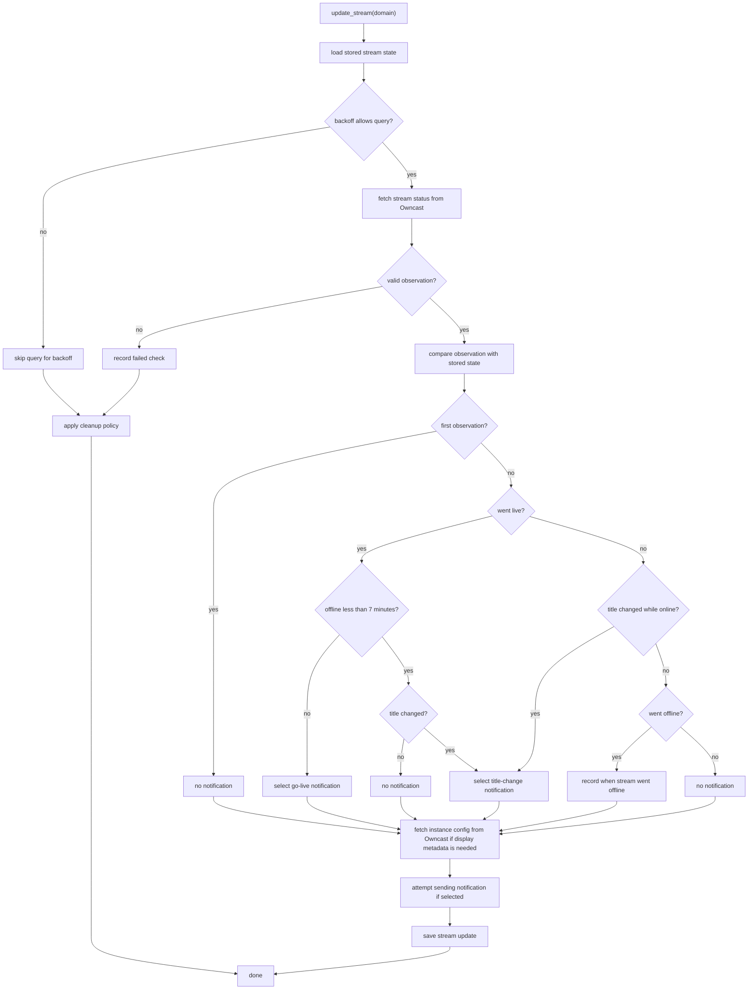

# OwncastSentry Package

This package contains the Maubot plugin runtime code for OwncastSentry. It
tracks room subscriptions to Owncast instances, polls subscribed streams,
detects stream state changes, and sends Matrix notifications.

This README gives maintainers a high-level map of how the package fits
together and where the important behavior lives. User-facing setup and command
usage belong outside this package. Function-level details belong in docstrings
or tests.

## Files

- `__init__.py`: Maubot plugin entry point, service wiring, command
  decorators, scheduler loop, shutdown, and metrics endpoint.
- `commands.py`: Maubot command handlers for subscribe, unsubscribe,
  subscriptions, and live listings.
- `config.py`: Maubot configuration proxy for the Prometheus metrics endpoint
  setting.
- `metrics.py`: Prometheus counters, gauges, registry setup, and response timing
  helpers.
- `notification_service.py`: Matrix notification formatting, broadcast,
  per-domain notification cooldowns, cleanup notices, and delivery metrics.
- `owncast_client.py`: bounded aiohttp client for Owncast `/api/status` and
  `/api/config` requests.
- `repository.py`: database schema migrations plus stream and subscription
  repositories.
- `stream_monitor.py`: stream update orchestration, state transition detection,
  progressive failure backoff, cleanup thresholds, notification decisions, and
  stream metrics.
- `subscription_manager.py`: subscription use cases, domain normalization, and
  first-subscription Owncast validation.
- `types.py`: immutable value objects, Owncast API response validation, derived
  stream status, update results, and subscription domain errors.

The package has a service-layer shape: `OwncastSentry.start()` builds the
services, commands call `CommandHandler`, command handlers call
`SubscriptionManager`, and scheduled updates call `StreamMonitor`.
`StreamMonitor` runs the main polling workflow: it checks Owncast streams,
applies backoff and cleanup rules, classifies state transitions, triggers any
live/title notifications, persists changed stream state, and records stream,
failure, and subscription metrics.

## Core Concepts

A few terms are used throughout the package:

- A stream is a tracked [Owncast](https://owncast.online/) instance, identified
  by its normalized bare domain. The stored entry for that domain is the stream
  record. There is one stream record per domain, even if multiple Matrix rooms
  subscribe to it.
- A subscription is a Matrix room's request to receive notifications for one
  stream domain.
- `StreamStateObservation` is one successful Owncast status API sample used by
  the monitor when updating stored stream state.
- `StreamConfigObservation` is metadata fetched from Owncast's config API,
  currently the instance name and tags used in notifications and periodic
  display-name refreshes.
- `StreamState` is an immutable snapshot of the latest persisted state for a
  stream: display metadata, the latest Owncast online flag, when that status was
  first observed by the bot, failure count, and the derived online, offline, or
  unknown status.

Durable state lives in the database. The `streams` table stores the latest
known display and state fields for each Owncast domain, and the `subscriptions`
table stores which Matrix rooms follow each domain.

Subscriptions belong to individual Matrix rooms, while stream state is shared
per domain. Notification delivery fans out by domain to the rooms currently
subscribed to that domain. Live/title notification text is built from the fresh
status observation and, when available, fresh config metadata for the update
being processed.

Stream identity is the normalized bare domain. Repositories, metrics,
notification state, and Owncast API calls all use that domain rather than the
original user-supplied URL.

Failures stay isolated at plugin boundaries. A bad command, failed stream
check, or room delivery is logged and counted without stopping unrelated
commands, stream updates, or notifications.

`StreamStateObservation`, `StreamConfigObservation`, `StreamState`,
`UpdateResult`, and `RoomSubscription` are immutable snapshots. State changes
are represented by new values that are persisted through repositories instead of
mutating existing objects.

## Plugin Boundary

Maubot interacts with the package through `OwncastSentry`. That plugin class is
the boundary between Maubot's runtime and the internal services that implement
OwncastSentry behavior.

`OwncastSentry.start()` is the composition root for one plugin instance. It
loads config, creates the Owncast client, repositories, metrics, notification
service, stream monitor, subscription manager, and command handler, then passes
dependencies into each service explicitly.

The plugin boundary owns Maubot integration: command registration, scheduled
polling, and lifecycle cleanup. Scheduled ticks load subscribed domains and
call `StreamMonitor.update_all_streams()`. `StreamMonitor` owns the per-stream
polling workflow, while notification delivery and delivery cooldowns stay in
`NotificationService`.

Internal services do not depend on Maubot globals, which keeps command handling,
scheduled polling, and tests wired through explicit dependencies.

## Subscription Management

`SubscriptionManager` coordinates the room-to-domain relationship. Command
handlers pass it user-supplied stream targets, and it turns those targets into
normalized domains before creating or removing stored data.

Subscribing a room creates a subscription for the normalized domain and creates
the shared stream record when needed. Domains with no current subscribers are
validated through `OwncastClient`; domains that already have subscribers reuse
the existing stream record instead of revalidating.

Unsubscribing removes one room's subscription to a domain. It does not delete
the shared stream record or make remote Owncast requests.

Listing methods return the subscriptions for one Matrix room with shared stream
state attached, so commands can display each instance's name, title, link,
status, and how long it has been online or offline.

## Owncast API Client

`OwncastClient` owns the aiohttp session used for Owncast API requests. It
fetches stream status and instance config, validates response shape, and turns
accepted responses into the value objects used by the rest of the package.

The session uses a plugin-specific User-Agent, a dummy cookie jar, no DNS cache,
a global connection limit, a per-host connection limit of one, and connect/read
socket timeouts. aiohttp's own DNS cache is disabled; resolver selection is left
to aiohttp and the runtime environment.

The per-host connection limit and keepalive settings are intentional. Each
Owncast instance is intended to keep at most one long-lived connection warm, so
minute-by-minute status checks avoid unnecessary TLS renegotiation.

Responses are accepted only when they are HTTP 200 JSON objects under the
configured size limit. Invalid JSON, non-object JSON, oversized bodies,
unexpected status codes, malformed API fields, connection errors, and timeouts
are logged and ignored.

The response-time metric is recorded only when a request completes and the
parsed response shape is valid. Failed requests remove any stale timing label
for that domain.

## Stream Monitoring

`StreamMonitor` runs the package's main polling workflow for tracked Owncast
instances. `update_stream()` owns the per-domain state machine: it compares the
stored stream state with the latest Owncast status response, decides whether to
send a notification, updates persistent state when needed, and records stream
metrics. Each poll first handles stored stream lookup, polling backoff, and
failed Owncast requests. Only a valid status response enters the stream transition
policy. `update_all_streams()` wraps this flow for many domains, isolates
per-domain exceptions, and records subscription-count metrics.

Each stream has a failure counter that tracks consecutive failed checks and
queries skipped for backoff. The counter drives both status and polling behavior:
a stream is displayed as unknown after more than 15 minutes of failed or
skipped checks, and later failures progressively reduce query frequency until
the monitor checks only every 15 minutes. Skipped queries still increment
the counter so cleanup can progress.

After each successful fetch from Owncast's
[`/api/status`](https://owncast.online/api/latest/#tag/Internal/operation/GetStatus)
endpoint, the monitor compares the stored stream state with the latest
observation to identify transitions, such as going online, going offline, or
changing title. Online/offline transitions are based on Owncast's `online` field.
The stream status timestamp is the bot's UTC observation time for the first
successful poll or an online/offline transition.

The first successful observation stores state and fetches config but suppresses
notifications, even if the stream is already live. After that, only
offline-to-online transitions can select go-live notifications; mid-session
title changes select title-change notifications.

Brief outages are treated as transient to avoid spamming Matrix rooms when an
instance is spotty. They do not select go-live notifications. If a stream returns
in under seven minutes with the same title, the monitor stores the new online
state without notifying rooms. If the title changed during that brief outage, the
monitor selects a title-change notification instead.

Instance config is fetched from Owncast's
[`/api/config`](https://owncast.online/api/latest/#tag/Internal/operation/GetWebConfig)
endpoint when a live/title notification is selected, on a stream's first
successful observation, and during the hourly refresh window for successfully
polled streams. The config response supplies the display name and tags for
notifications. If config is fetched successfully during an update, the persisted
stream name is refreshed from it; otherwise the stored name is left unchanged.

Selecting a notification does not guarantee a Matrix message. The notification
service can still suppress delivery when its per-domain live/title cooldown is
active, which prevents repeated messages from noisy stream state changes. That
delivery behavior is covered below.

## Cleanup Policy

A domain that remains unreachable is eventually cleaned up. The failure counter
represents minute ticks, including skipped backoff ticks.

After 83 days of continued failed or skipped checks, `StreamMonitor` sends a
cleanup warning to all rooms subscribed to the domain. After 90 days or more of
continued failed or skipped checks, it sends a deletion notice, deletes all
subscriptions for the domain, deletes the stream record, clears the monitor and
notification caches for that domain, and asks `MetricsService` to remove
existing per-domain metric labels. The enclosing update cycle may later recreate
the subscription-count gauge for that domain at zero.

## Notification Delivery

`NotificationService` sends notifications to every room subscribed to a domain.
Delivery failures are isolated per room, so one failed Matrix send does not
block notifications to other subscribed rooms.

Live and title-change notifications share a per-domain cooldown. The cooldown
is recorded only when at least one room receives the message. If there are no
subscribed rooms, or every delivery fails, no cooldown is recorded.

Live/title notification text normalizes remote stream metadata before composing
the message, so instance-provided names, titles, and tags cannot add unexpected
line breaks or otherwise distort the notification. Messages fall back to the
domain when a display name is unavailable.

Cleanup warning and deletion notices bypass the live/title cooldown, but still
record delivery metrics.

## Command Handling

`OwncastSentry` exposes Maubot command decorators in `__init__.py`, but command
behavior lives in `CommandHandler`. The plugin entry points are thin wrappers
that catch unexpected exceptions and record command error metrics.

`CommandHandler.subscribe()` and `CommandHandler.unsubscribe()` translate
domain errors into user-facing Matrix replies. `subscriptions()` and `live()`
read room subscription listings with stream state attached and render Markdown
output with escaped untrusted text.

Command listings are limited to the current room and ordered by domain through
repository queries. `subscriptions()` includes online, offline, and unknown
streams. `live()` includes only streams marked online with a failure count at or
below the unknown threshold.

## Persistence

Maubot owns the database connection and runs the schema upgrades registered by
`repository.py`. The repository classes wrap that database handle and expose the
package's stream and subscription persistence operations.

The persistence model stores one stream record per normalized domain and one
subscription row per room/domain pair. `SubscriptionManager` normalizes user
input before repository calls. `StreamRepository` writes display and state
fields, while failure counters use dedicated methods.
`SubscriptionRepository` raises domain-specific errors for duplicate adds and
missing removes.

Room subscription listings join `subscriptions` to `streams`, which means
orphaned subscription entries without a matching stream record are skipped in
room display queries.

## Metrics

`MetricsService` uses a private `CollectorRegistry` so plugin metrics do not mix
with process-global Prometheus collectors.

The registered metrics cover:

- notification delivery attempts by type and result;
- current stream status per domain (`1` online, `0` offline, `-1` unknown);
- subscription count per domain;
- consecutive check failures per domain;
- successful Owncast API response duration per domain;
- build/version information;
- open aiohttp connection count;
- internal scheduler and command errors.

Known counter label combinations are initialized to zero. This keeps the
Prometheus output stable before any events have occurred.
